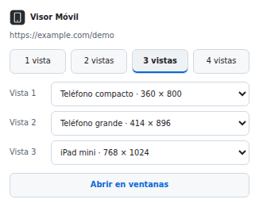

# Visor Móvil

**Compara la página activa en hasta cuatro ventanas con tamaño de teléfono o tablet.** Ligero, de código abierto y sin cuenta.



## Instalación

| Navegador de escritorio | Cómo cargarlo |
| --- | --- |
| Brave, Chrome y Edge recientes | Descarga el ZIP de Chromium en [Releases](https://github.com/ig-nx/visor-movil-public/releases/latest), descomprímelo y elige la carpeta que contiene `manifest.json` en **Extensiones → Modo desarrollador → Cargar descomprimida**. También puedes usar la carpeta `extension/` del repositorio. |
| Firefox 140 o posterior | Descarga el ZIP de Firefox y cárgalo en `about:debugging#/runtime/this-firefox` → **Cargar complemento temporal**. Es un paquete sin firmar: la carga temporal termina al reiniciar Firefox. |
| Safari y navegadores móviles | No se distribuyen paquetes para estas plataformas. Safari requiere [empaquetado específico](https://developer.apple.com/documentation/safariservices/packaging-a-web-extension-for-safari). |

## Uso

Abre una web, pulsa el icono de Visor Móvil, elige **1–4 vistas** y selecciona un perfil por ventana. Pulsa **Abrir en ventanas**. La pestaña original no cambia y la extensión conserva tus perfiles, no la URL.

Los tamaños son **aproximados**: sirven para revisar diseño responsive, no para emular iOS, Android o el tacto. **Pantalla completa** ocupa el monitor y no conserva el tamaño móvil.

## Desarrollo

```sh
npm ci
npm test
npx playwright install chromium
npm run test:browser
npm run build:firefox
```

La variante Firefox se genera en `dist/firefox/`. El código de la extensión no tiene dependencias de ejecución.

[Licencia MIT](LICENSE) · [Privacidad](PRIVACY.md) · [Notas de diseño](docs/diseno.md)
